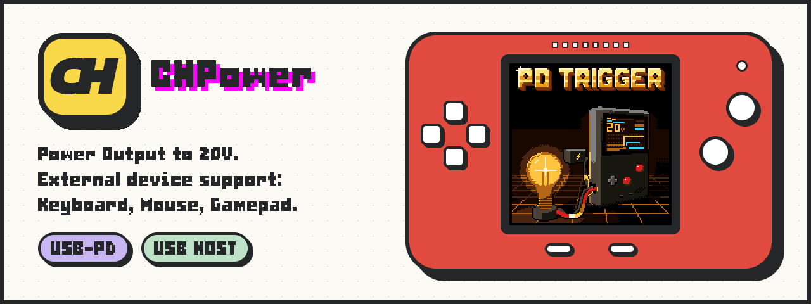
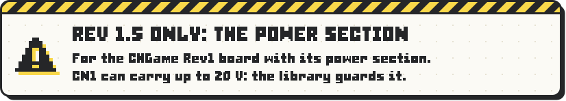

<a id="readme-top"></a>

<div align="center">

<a href="https://github.com/bateske/CHGame"></a>

<p>
<a href="https://github.com/bateske/CHGame"></a>&nbsp;
<a href="#-get-started"></a>&nbsp;
<a href="docs/design.md"></a>&nbsp;
<a href="https://community.arduboy.com/c/color/56"></a>
</p>

[](https://github.com/bateske/CHGame)
[](#-get-started)
[](libraries/CHPower/README.md)
[](docs/design.md)

<br>



<br>

</div>

**CHPower** contains two Arduino libraries for the power section of the
[CHGame](https://github.com/bateske/CHGame) Rev 1.5 board:

- **CHPower** runs the USB-PD sink and the protected output (CN1). With a
  USB-C PD charger connected, CN1 can be used as an adjustable bench
  supply.
- **CHUSBHost** runs the USB port as a host, powered from the battery. It
  supports keyboards, mice, gamepads and hubs. A powered USB-C hub can
  also power and charge the board while it stays the host.

The safety checks are in the libraries, not in the sketches. A sketch only
links the parts it calls. Each library comes with an example app.

These libraries are kept separate from CHGame because only the Rev 1.5 has
the power section. Later boards may not have it.

**Try the example apps without building them:** download the
[multi-cart (`CHPower-Examples.chgame`)](https://github.com/bateske/CHPower/releases/latest/download/CHPower-Examples.chgame)
or the
[SD card files (`CHPower-Examples-sdcard.zip`)](https://github.com/bateske/CHPower/releases/latest/download/CHPower-Examples-sdcard.zip).
Both contain PD TRIGGER and USB HOST for the Rev 1.5. Unzip
the SD card files to the root of an empty FAT32 card.

<details open>
<summary><b>Contents</b></summary>

1. [Hardware](#-hardware)
2. [Get started](#-get-started): [install](#2-install-the-libraries), [first sketches](#first-sketches)
3. [Code size](#-code-size)
4. [Safety](#-safety)
5. [Examples](#-examples)
6. [Licences](#-licences)

</details>

## ⚡ Hardware

The Rev 1.5 is a CHGame Rev1 (same MCU, same pins, same games) with a power
section on the USB-C port:

| Feature | Hardware | API |
|---|---|---|
| **USB-PD sink** | CH32X035 USBPD peripheral, connected through the CH211's CC switches | `pd::` PD 2.0 and 3.0, fixed supplies and PPS (20 mV steps), data and power role swaps for powered hubs |
| **Protected output (CN1)** | CH211 high-side switch, INA226 current meter and cut-off, eFuse | `pwr::` enable and disable, current limit, measurements |
| **USB host** | Boost converter from the battery (PA0), USBFS peripheral in host mode | `host::` keyboards, mice, HID gamepads, Xbox 360 and Switch Pro pads, hubs (up to two levels), powered PD hubs |

On a plain Rev1, or a Rev 1.5 running ordinary CHGame games, the power
section stays off and the port works as a normal 5 V charging port.

### Pins

The CH32X035 pins the libraries use on the Rev 1.5. The libraries own these
pins, so a sketch using CHPower must not reconfigure them. The one exception
is sharing the I2C bus, described below the table.

| Pin | Name | Function | Used by |
|---|---|---|---|
| PA0 | HOST_EN / VBUS sense (`PIN_VBUS_SENSE`) | Output high: battery boost on, 5 V to the port (host mode). Analog input: VBUS sense, ADC1 channel 0, about 81 mV of VBUS per count. A 1 kΩ pull-down (R11) keeps the boost off after reset. Do not call `pinMode`, `digitalWrite` or `analogRead` on it. | CHPower (`pwr::`), CHUSBHost (`host::`) |
| PC14 | CC1 | USB-C CC1, through the CH211's CC switches to the USBPD peripheral | CHPower (`pd::`) |
| PC15 | CC2 | USB-C CC2, through the CH211's CC switches to the USBPD peripheral | CHPower (`pd::`) |
| PC16 | USB D− | USBFS data, in host mode | CHUSBHost (`host::`) |
| PC17 | USB D+ | USBFS data, in host mode | CHUSBHost (`host::`) |
| PC18 | SDA (CN2) | I2C data (software I2C, 4.7 kΩ pull-up). SWDIO after reset. | CHPower (`pwr::`) |
| PC19 | SCL (CN2) | I2C clock (software I2C, 4.7 kΩ pull-up). SWCLK after reset. | CHPower (`pwr::`) |

The I2C bus on CN2 carries the CH211 (addresses 0x35, and 0x34 for its
fast read) and the INA226 (0x40). Other CN2 accessories can share the bus
through `Wire` from the main loop, at other addresses. On a Rev0 board PA0
is the H1 header and PC14/PC15 are buttons, so a Rev0 build stops with an
error.

### Repository contents

| | Item | Location |
|---|---|---|
| 🔋 | **CHPower** library, `#include <CHPower.h>`: power section, USB-PD sink, CN1, PD log | [`libraries/CHPower/`](libraries/CHPower/README.md) |
| 🔌 | **CHUSBHost** library, `#include <CHUSBHost.h>`: USB host and device drivers (requires CHPower) | [`libraries/CHUSBHost/`](libraries/CHUSBHost/README.md) |
| 🎛 | **CHPDTrigger** example: USB-PD trigger and bench supply | [`libraries/CHPower/examples/CHPDTrigger/`](libraries/CHPower/examples/CHPDTrigger/README.md) |
| ⌨️ | **CHUSBHost** example: device viewer, powered hubs, device log | [`libraries/CHUSBHost/examples/CHUSBHost/`](libraries/CHUSBHost/examples/CHUSBHost/README.md) |
| 📐 | **Design notes**: CH211 and INA226 rules, host mode entry sequence, reset behaviour | [`docs/design.md`](docs/design.md) |
| 🧰 | **Tools**: code size measurement, README images, the examples multi-cart and its cover | [`tools/`](tools/) |
| 📝 | **Changelog** | [`CHANGELOG.md`](CHANGELOG.md) |

<p align="right"><a href="#readme-top">back to top ↑</a></p>

## 🚀 Get started

### 1. Install the CHGame board package

Install the CHGame board package, version **0.4.0 or later**. It provides
the *CHGame Rev1* board and the CHGame library. In the Arduino IDE, add
this URL under *File > Preferences > Additional Boards Manager URLs*, then
install *CHGame* in the Boards Manager. See
[CHGame's Get started](https://github.com/bateske/CHGame#-get-started) for
details.

```
https://github.com/bateske/CHGame/releases/latest/download/package_chgame_index.json
```

### 2. Install the libraries

Download `CHPower-<version>.zip` and `CHUSBHost-<version>.zip` from the
[latest release](https://github.com/bateske/CHPower/releases/latest). In
the Arduino IDE, add each one with *Sketch > Include Library > Add .ZIP
Library*, then restart the IDE. CHUSBHost requires CHPower, so install
both even if you only use the USB host.

To track the repository instead, clone it and copy both folders from
`libraries/` into the `libraries` folder of your sketchbook (shown under
*File > Preferences > Sketchbook location*):

```bash
git clone https://github.com/bateske/CHPower
cp -r CHPower/libraries/CHPower CHPower/libraries/CHUSBHost ~/Arduino/libraries/
```

### 3. Select the board and open an example

Select *Tools > Board > CHGame > CHGame Rev1* (the Rev 1.5 uses the Rev1
board definition). Open *File > Examples > CHPower > CHPDTrigger* or
*File > Examples > CHUSBHost > CHUSBHost* and upload it. Building for Rev0
fails with an error, because the power section's pins are buttons on that
board.

### First sketches

Request 9 V from a charger, then enable CN1 with a 0.5 A cut-off:

```cpp
#include <CHGame.h>
#include <CHPower.h>

void setup() {
    chgame.boot();
    pwr::begin();               // call first: output inhibited, CC set as a plain sink
    pd::start();                // start the PD sink: detection, then the charger's offer
}

void loop() {
    if (!chgame.nextFrame()) return;
    chgame.pollButtons();
    pd::service();              // call every loop: PD sink and safety checks
    if (chgame.justPressed(A_BUTTON)) pd::request(2);       // second supply in the offer, 9 V on most chargers
    if (chgame.justPressed(B_BUTTON) && pd::contractMv()) pwr::enableCn1(500);   // CN1 on, 0.5 A cut-off
}
```

Read a keyboard on battery power:

```cpp
#include <CHGame.h>
#include <CHUSBHost.h>

void setup() {
    chgame.boot();
    pwr::begin();
    host::begin(host::KEYBOARD);    // link only the keyboard driver
    host::enter();                  // wait for a device, then power it
}

void loop() {
    if (!chgame.nextFrame()) return;
    host::service();
    host::Key k;
    while (host::nextKey(k)) { /* k.ch: 'a', 'B', '\n' ... */ }
}
```

<p align="right"><a href="#readme-top">back to top ↑</a></p>

## 🪶 Code size

The CHGame has 50 KB of flash and 18 KB of RAM, so a sketch links only the
parts it calls. The libraries are not a framework: call what you need from
your own loop.

- **CHPower:** `pwr::begin()` is the core. The PD sink, CN1 and the PD log
  are each linked on their first call. They connect through hooks that are
  set when a part is first used, so the core does not reference them.
- **CHUSBHost:** each device type has its own driver. Only the drivers
  named in `host::begin()` are linked, and `host::ALL` links all of them.
  The PD code is linked only for `host::PD_SWAP` (powered hubs) or when
  the sketch calls `pd::` itself. Otherwise CHPower pauses the PD sink
  without linking it.

Sizes of minimal sketches compared to the bare CHGame frame loop,
measured with `python tools/sizes.py` (rev1, -Os, LTO):

| Sketch calls | Flash | RAM |
|---|---:|---:|
| `pwr::begin()`: power section core and safety checks | +2.4 KB | +72 B |
| + `pd::start()`: USB-PD sink | +7.6 KB | +372 B |
| + `pwr::enableCn1()`: protected output | +8.7 KB | +412 B |
| + `plog::begin()`: PD log | +9.5 KB | +2,348 B |
| `host::begin(host::MOUSE)` | +8.4 KB | +760 B |
| `host::begin(host::KEYBOARD)` | +9.3 KB | +808 B |
| `host::begin(host::GAMEPAD)` | +9.9 KB | +948 B |
| `host::begin(host::KEYBOARD \| host::MOUSE \| host::HUB)` | +10.6 KB | +1,044 B |
| `host::begin(host::PADS)`: HID, Xbox 360 and Switch Pro | +10.9 KB | +948 B |
| `host::begin(host::ALL)`: all drivers, chained hubs, probe log | +15.1 KB | +3,096 B |
| `... KEYBOARD \| MOUSE \| HUB \| PD_SWAP`, Try.SNK, PD sink: powered hubs | +17.1 KB | +1,376 B |

<p align="right"><a href="#readme-top">back to top ↑</a></p>

## 🛡 Safety

CN1 can output up to 20 V and 2.4 A, and host mode puts the battery's 5 V on the
port. The libraries enforce the following so that sketches don't have to:

- **CN1 follows the PD contract.** `enableCn1()` is refused if there is no
  contract, if the requested limit exceeds the contract's current, or in
  host mode. CN1 turns off when the contract ends, and the limit is
  lowered when the contract's current drops. The charger's voltage is
  trusted, and the output follows a voltage change.
- **CN1 is checked every 10 ms.** It turns off on an INA226 cut-off (in
  hardware), on reverse current, or if the CH211 resets or stops
  responding.
- **The board never drives 5 V against another source.** Host power is
  refused while a charger or PC is connected or CN1 is on, and it turns
  off within milliseconds of an unplug. When a powered hub takes over,
  the board's 5 V is off and VBUS is below 0.8 V before the hub's power
  comes on.
- **Exiting to the CHGame menu powers everything down** (START held, or
  `exitToMenu()`), through a hook in the CHGame library that CHPower sets.

The full list, and what survives a reset, is in
[CHPower's README](libraries/CHPower/README.md#what-it-guards-by-itself).

<p align="right"><a href="#readme-top">back to top ↑</a></p>

## 🕹 Examples

| PD TRIGGER | USB HOST |
|---|---|
|  |  |
| Uses a USB-C charger as a bench supply: any voltage the charger offers (PPS in 20 mV steps) on CN1, with a meter, a scope, a current cut-off, a guided tour and the PD log. [README](libraries/CHPower/examples/CHPDTrigger/README.md) | Shows keyboards, mice and gamepads (HID, Xbox 360, Switch Pro), connected directly or through hubs, each in its own view, plus a device log that a PC can read. Supports powered USB-C hubs, connected either before or after the hub has power. [README](libraries/CHUSBHost/examples/CHUSBHost/README.md) |

Both use the CHGame apps' "secret agent" visual style and include box art
for the CHGame game menu. Run `chgame export` in an example's folder to
make a `.chgame` file for a Rev1 SD card.

<p align="right"><a href="#readme-top">back to top ↑</a></p>

## 📜 Licences

| Path | Licence |
|---|---|
| `libraries/CHPower/`, `libraries/CHUSBHost/` (except their examples), `tools/`, `docs/`, root files | Apache-2.0 (`LICENSE`, `NOTICE`) |
| `libraries/CHPower/examples/CHPDTrigger/`, `libraries/CHUSBHost/examples/CHUSBHost/`, `libraries/CHUSBHost/examples/CHPDHubProbe/` | MIT (each has its own `LICENSE`) |

The USB-PD sink and the USB host transfers are adapted from WCH's CH32X035
examples. WCH's notice limits that code to WCH microcontrollers, which the
CH32X035 is. [NOTICE](NOTICE) lists the files. The box art titles use
third-party pixel fonts, credited in each example's `tools/art/title.txt`.
The lettering in this README's images is Bitrimus (CC0).

<p align="right"><a href="#readme-top">back to top ↑</a></p>
